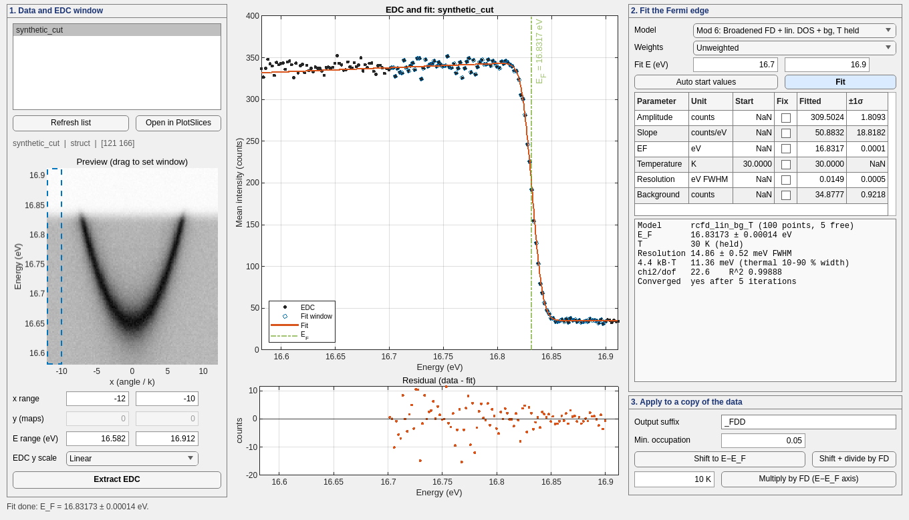
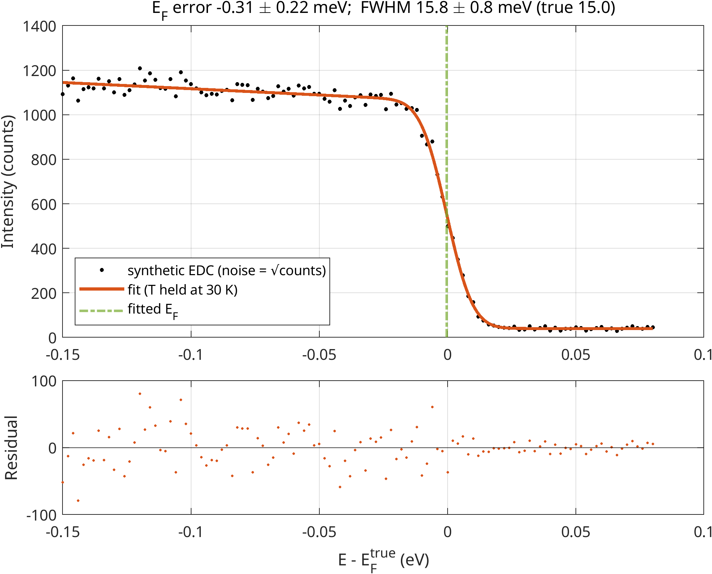
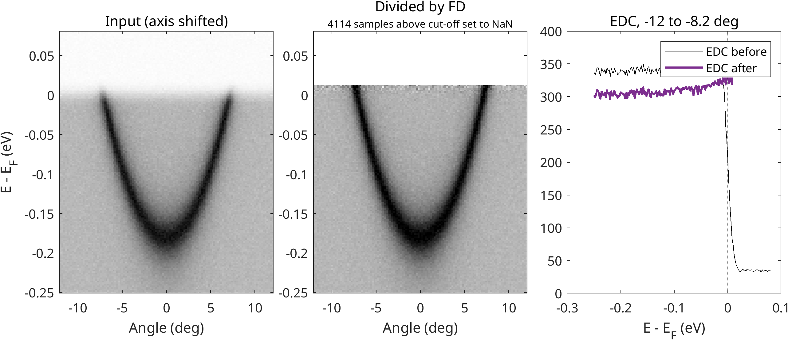

# FDD improvement log

> Historical implementation/validation record. Recorded tests describe the dated revision,
> not the current live session. On 23 November 2026 the upgrade was added to OX_ARPES:
> code `GUI/FDD/` (since the GUI feedback below; first `GUI/`), tests `tests/TestFDDCore.m` and `tests/TestFDDGui.m`
> (renamed from `test_fdd_core`/`test_fdd_gui`), figures in `doc/`. Paths below have been updated
> to those locations; see [Repository integration](#repository-integration--23-november-2026).
>
> Dated review and implementation record, following the format of the yulinARPES
> `doc/plotBZ_V1_improvement_log.md` and the `improve-scientific-guis` work templates.
> The results below describe the versions tested on 23 November 2026.

* **Date / runtime / checkout:** 23 November 2026. MATLAB R2023a Update 8 (Linux),
  base MATLAB only, run as the normal user. yulinARPES `56f394e`, used as reference only and not modified.
* **Request:** "Please review the new docs and the scientific gui upgrade skill in yulinARPES
  first. Then please review the FDD folder in Google Drive … provide a review report and use
  the skill to upgrade it."
* **Status:** done. Review: [FDD_review.md](FDD_review.md). Upgraded copy:
  `GUI/`. The original Drive files and the local read-only download are untouched.

## Prior notes read

yulinARPES `AI_skills/improve-scientific-guis/SKILL.md` with `references/experience-record.md` and
`references/work-templates.md`; `AI_skills/SKILLS_MAP.md`; `AI_skills/session_summary.md`
(new in `56f394e`); `doc/PlotSlices_review.md` (new); `doc/plotBZ_V1_review.md` and
`doc/plotBZ_V1_improvement_log.md` (worked examples); the FDD `README.md`. The commits
`dc7fb88..56f394e` change PlotSlices, the v5 browser and their tests and logs; none touch FDD.
OX_ARPES has its own `DataAnalysis/fermi_level/fit_fermi_edge_ox.m`. It also uses the Curve
Fitting Toolbox and already insists that "Resolution can only be fitted when
FixTemperature = true", which matches finding F2 here. It was read for context only.

## Plan and contracts

| User outcome | Contract to preserve | Acceptance evidence |
|---|---|---|
| Fits that run on the installed MATLAB | Same six physical models; legacy "Mod 1–6" names accepted | Toolbox-free implementation; tests on R2023a |
| Trustworthy E_F, T and resolution | E − E_F < 0 occupied; k_B = 8.617333262e-5 eV/K; resolution as Gaussian FWHM (eV); energies in eV | Independent-integral oracle; noiseless and Monte-Carlo recovery |
| Correct, non-destructive correction | Copies written as `<name>_EF`, `<name>_FDD`, `<name>_xFDD`; source never changed; energy along y (cuts) or z (maps) | Tests on structs and on `OxA_CUT`/`OxA_MAP` objects |
| Tidy GUI | Data → Fit → Apply order; fitted values visibly separated from inputs | Fresh screenshot at 1360×780 |
| AI control | Same backend as the buttons; explicit defaults; no silent overwrite | Public-method GUI tests |

Decisions and why:

* **Programmatic `uifigure` class (`FDD_fit_app.m`) instead of editing the `.mlapp`.** The
  `.mlapp` is a binary App Designer container that can't be produced reliably from the
  command line. A plain class can be diffed, reviewed and tested, and it keeps the App
  Designer look (uifigure components). The original `.mlapp` remains the legacy entry point.
* **Numerics are split out of the GUI:** `fdd_model`, `fdd_fermi`, `fdd_fit_edc`,
  `fdd_initial_guess`, `fdd_models`, `fdd_extract_edc`, `fdd_correct_data`, `fdd_multiply_fd`
  and `fdd_energy_axis`. The GUI only gathers inputs, calls them and draws the results.
* **Own Levenberg–Marquardt fitter** with a central-difference Jacobian, parameter scaling and
  box bounds (T ≥ 0.1 K, 0 ≤ FWHM ≤ 1 eV). It returns 1σ errors from the Jacobian scaled by
  χ²/dof, the correlation matrix and warnings. It needs no toolbox and has about 100 lines of logic.
* **Broadened model by quadrature in units of σ** (nodes ±6σ, spacing min(0.01σ, k_BT/2)).
  The first version used a grid whose length depended on T and σ. That made the
  finite-difference Jacobian noisy, and the noiseless free-T fit stalled at T = 37.4 K /
  FWHM = 12.9 meV (RSS 48 vs 0.025 at the truth). The node set now scales smoothly with σ,
  and the same fit recovers 30.000 K / 15.00 meV.
* **The linear DOS is broadened together with the occupation** (physically exact). The
  original multiplied the linear term by the broadened FD; the difference is 1.7×10⁻³ of the amplitude.
* **Default model is `rcfd_lin_bg_T` (Mod 6), with T held at the measured temperature.**
  Mod 5 is kept but warns when |r(T, FWHM)| > 0.9 or the pair is not separable.
* **Linear-space least squares** (optional Poisson weights for raw counts) replaces log-space fits.
* **Occupation cut-off instead of clipping:** after division by FD, samples with f < 0.05
  (adjustable `MinOccupation`) are set to NaN. No other value is changed: no clipping and no
  zeroing of negatives.
* **Data-driven start values:** E_F from the steepest descent of a smoothed EDC; the 10–90 %
  width split between thermal (4.394 k_BT) and Gaussian (1.089 FWHM) broadening; plateaus for
  A and B. Works on kinetic-energy axes.
* **EDC selection** comes from the selected workspace variable, not from "the first object
  with XData" in a numbered figure. The angle, y (maps) and energy windows are numeric fields,
  or a rectangle dragged on the in-app preview. `PlotSlices` stays available as an optional
  "Open in PlotSlices" button.
* **Not done** (scope): angle-dependent E_F; an App Designer `.mlapp` rebuild; changes to yulinARPES/OX_ARPES (OX_ARPES integration followed the same day; see below).

## Implementation

`GUI/` (originally a standalone `upgraded/` folder):

| File | Role |
|---|---|
| `FDD_fit_app.m` | GUI: three columns (1. Data and EDC window, 2. Fit the Fermi edge, 3. Apply to a copy of the data), plus EDC/fit and residual plots and a status line. Public methods for scripted control. |
| `fdd_model.m`, `fdd_fermi.m`, `fdd_constants.m` | model, stable FD (tanh form; T = 0 step), constants |
| `fdd_fit_edc.m`, `fdd_initial_guess.m`, `fdd_models.m` | fitter, start values, model presets with legacy aliases |
| `fdd_extract_edc.m`, `fdd_energy_axis.m` | EDC from a cut or map with validated axes |
| `fdd_correct_data.m`, `fdd_multiply_fd.m` | E_F shift, renormalisation, multiplication, all on copies |
| `tests/` (repository root) | `TestFDDCore.m` (16 tests), `TestFDDGui.m` (6 tests; one each added in the second review), `fdd_synthetic.m` (independent-integral fixture), `fdd_recovery_table.m`. The review-only scripts (`review_original_checks.m`, `make_fdd_figures.m`, `run_fdd_tests.m`) need the original program or a display and were not added to the repository. |
| `doc/fdd_*.png` | screenshots and 300 dpi plots |
| `doc/FDD_user_guide.md`, `AI_skills/ox-arpes-fdd-fit/SKILL.md` | user guide and repository-local operation skill (not installed for automatic discovery) |

Original-to-upgrade mapping:

| Original | Upgrade |
|---|---|
| ListBox of all base variables (86–93) | lists only variables with consistent x/y(/z)/value |
| Plot → PlotSlices (99) | in-app preview; optional "Open in PlotSlices" |
| Fig. Num + Get EDC (`getrect`, 104–143) | x / y / E window fields, or drag on the preview; Extract EDC |
| Get Fit Area (`getrect`, 146–358) | Fit E window fields + Fit button |
| Mod 1–6 radio buttons | model drop-down "Mod N: description" + per-parameter Fix |
| Amplitude…Resolution fields (in/out mixed) | table: Start (input), Fix, Fitted, ±1σ (outputs) |
| Offset (361–371) | Shift to E−E_F → `<name>_EF` |
| Offset & Renormalise (374–415) | Shift + divide by FD → `<name>_FDD` (suffix editable), occupation cut-off |
| Multiply by FDD (428–439) | Multiply by FD → `<name>_xFDD`, cuts and maps |

## Validation (23 November 2026, R2023a)

* **Tests:** `run_fdd_tests` (standalone copy), **20 of 20 passed**, 0 failed, about 15 s. The tests check:
  * the analytical FD invariants and the unit-area kernel;
  * the model against an independent `integral` (≤ 2×10⁻⁴ of the amplitude; 9.5×10⁻¹⁰ for the unit edge);
  * noiseless recovery in all six models (E_F within 0.02 meV, T within 2 %, FWHM within 0.3 meV);
  * 40-seed Monte Carlo with T held: E_F bias < 0.3 meV, FWHM bias < 5 %, and the scatter of E_F within 0.6–1.6× the reported σ;
  * a kinetic-energy axis (E_F = 16.8317 eV);
  * descending axes, NaN samples and zero counts;
  * that the T–FWHM degeneracy is flagged, with fitted RSS ≤ the RSS at the truth;
  * that invalid inputs fail with specific error IDs;
  * correction of struct and `OxA_CUT`/`OxA_MAP` copies, including NaN masking and an unmodified source;
  * that Multiply is the inverse of Renormalise;
  * EDC windows on reversed axes;
  * the legacy aliases;
  * the GUI: list filtering, cut and map workflows through the public methods, refusal to overwrite, protection of the source, a read that doesn't reset state, and error IDs before data or fit.
* **Warnings:** apart from MATLAB's start-up notice that it switched to software OpenGL, no warnings were printed. Singular-matrix warnings inside the
  LM step are deliberately suppressed (and restored afterwards) because the damping handles them.
* **Recovery table** (`tests/fdd_recovery_table.m`; truth E_F = 12.30 meV, T = 30 K, FWHM = 15 meV):

| Model | Data | E_F fit (meV) | T fit (K) | FWHM fit (meV) |
|---|---|---|---|---|
| Mod 1–4, 6 | noiseless | 12.300 | 30.00 (held in Mod 6) | 15.00 (Mod 4, 6) |
| Mod 5 | noiseless | 12.300 | 30.00 | 15.00 |
| Mod 1 `fd` | noisy (seed 42) | 12.138 ± 0.146 | 29.31 ± 1.48 | — |
| Mod 4 `rcfd` | noisy | 12.232 ± 0.198 | 23.51 ± 82.62 | 15.75 ± 15.67 |
| Mod 5 `rcfd_lin_bg` | noisy | 12.240 (σ not defined, flagged) | 0.29 (degenerate, flagged) | 17.78 |
| **Mod 6 `rcfd_lin_bg_T`** | noisy | **12.251 ± 0.236** | 30 (held) | **14.19 ± 0.93** |

  (Mod 1–3 data were generated without resolution broadening, matching their model.)
* **GUI demo** on a synthetic cut (kinetic energy, parabolic band, √counts noise; window
  −12° to −10°, away from the band crossing at about ±7.2°): E_F = 16.83173 ± 0.00014 eV
  (true 16.83170), FWHM = 14.86 ± 0.52 meV (true 15), χ²/dof = 22.6, R² = 0.9989, converged in 5 iterations.
* **Code Analyzer:** 0 notices in all 18 upgraded `.m` files of the standalone copy, against 20 in `FDD_new_exported.m`.
* **Runtime note:** uifigure windows did not open from `matlab -batch` on the box at first.
  MATLABWindow needed `libgtk2.0-0t64`, which I installed with apt, and it conflicted with
  MATLAB's bundled FreeType. Batch screenshots therefore ran with
  `LD_PRELOAD=/lib/x86_64-linux-gnu/libfreetype.so.6`. The MATLAB installation itself was not changed.

## Visual artifacts

* `doc/fdd_upgraded_gui.png`: whole window via `exportapp`, which is screen resolution
  (1024×587 image of the 1360×780 window). `exportgraphics` cannot include UI components.
  Checked: the first capture showed the preview axes overlapping the window fields in the
  left column. Putting the axes in their own container fixed it. Table columns, model labels
  and button text were widened or shortened until nothing was clipped.
* `doc/fdd_original_gui.png`: the original app opened in R2023a, for comparison.
* `doc/fdd_fit_example.png` (300 dpi): Mod 6 fit, residuals, errors in the title.
* `doc/fdd_T_resolution_degeneracy.png` (300 dpi): 40-edge Monte Carlo, T free vs held.
* `doc/fdd_correction_example.png` (300 dpi): cut before and after division by FD, with EDCs.







## Remaining limitations and unperformed checks

* No measured gold or sample data were fitted (`others/matlab.mat` was not downloaded: 173 MB,
  over the Drive download limit of the tool used).
* Not exercised: the mouse-drag rectangle on the preview, the overwrite confirmation dialog,
  and "Open in PlotSlices" (PlotSlices needs the GUI Layout Toolbox, which isn't installed here).
  The same code paths below them are tested through the public methods.
* Angle-dependent E_F is not implemented. `MinOccupation` masking means corrected maps have
  NaN above about E_F + 3 k_BT.
* Only R2023a on Linux was tested. `uifigure`/`uigridlayout` need R2018b or later; `exportapp` R2020b or later.
* No independent agent evaluation of the operation skill was performed.

## Final state and launch path

`addpath(fullfile(root,'GUI','FDD')); app = FDD_fit_app;`. Scripted use:
`R = fdd_fit_edc(E, I, 'Temperature', T)` (see [FDD_user_guide.md](FDD_user_guide.md)).
Tests: `runtests({fullfile(root,'tests','TestFDDCore.m'), fullfile(root,'tests','TestFDDGui.m')})`.

## Skill session-summary addition (proposed for yulinARPES `AI_skills/session_summary.md`, not applied there)

```markdown
## FDD Fermi-edge fitting — 23 November 2026
Purpose and paths: FDD upgrade (Drive FDD folder); operation skill OX_ARPES AI_skills/ox-arpes-fdd-fit/SKILL.md.
API: fdd_fit_edc (default model rcfd_lin_bg_T when Temperature is given), fdd_extract_edc,
fdd_correct_data (copies only; MinOccupation 0.05 → NaN), FDD_fit_app public methods; no overwrite without 'Overwrite', true.
Runtime: MATLAB R2023a, base MATLAB only, batch mode.
Validation: 20/20 tests; synthetic recovery and Monte Carlo; 0 analyzer notices.
Independent evaluation: none.
Limitations: no measured data; drag-ROI and PlotSlices button not exercised.
```

## Repository integration — 23 November 2026

Requested: "Please add the new FDD to the work tree of OX_ARPES, record the log, doc and AI skills."
Changes are left uncommitted in the working tree for review.

| Item | Location |
|---|---|
| App and backend (11 files) | `GUI/` (`FDD_fit_app.m`, `fdd_*.m`), next to `OxArpes_DataProcess.m` and its `ox_data_process*` backend; picked up by `addpath(fullfile(root,'GUI'))` as in the README. First placed in `DataAnalysis/fermi_level/FDD/`, moved to `GUI/` at Calvin's request before the commit (since the GUI feedback: `GUI/FDD/`) |
| Tests | `tests/TestFDDCore.m`, `tests/TestFDDGui.m`, helpers `tests/fdd_synthetic.m`, `tests/fdd_recovery_table.m`; path set from the test file location; discovered by `tests/run_tests` |
| Docs | `doc/FDD_review.md`, `doc/FDD_improvement_log.md` (this file), `doc/FDD_user_guide.md`, `doc/FDD_skill_session_summary.md`, five `doc/fdd_*.png` (about 0.6 MB in total) |
| Operation skill | `AI_skills/ox-arpes-fdd-fit/SKILL.md` (renamed from `fdd-fermi-fit` to match the `ox-arpes-*` naming) |
| Indexes | `README.md` (FDD section, toolbox note, tests), `Contents.m`, `tests/README.md` |

Not added: the original `FDD_new.mlapp`/export, the `others/` prototypes, the 173 MB
`matlab.mat`, and the review-only scripts that need the original program or a display.

Name clashes: `which -all` on the saved path (OX_ARPES and yulinARPES) found no existing
function, class or script named `FDD_fit_app`, `fdd_*`, `TestFDDCore`, `TestFDDGui`,
`fdd_synthetic` or `fdd_recovery_table`. The nearest name is the yulinARPES class method
`@FitFermiSurface/fdDistribution`, which does not clash.

Validation from the repository location (MATLAB R2023a Update 8, `matlab -batch`):
`runtests` on `TestFDDCore.m` and `TestFDDGui.m` gave **20 of 20 passed**, 0 failed,
0 incomplete (16.7 s), including the `OxA_CUT`/`OxA_MAP` correction test. `which FDD_fit_app`
resolved to the first location (`DataAnalysis/fermi_level/FDD/FDD_fit_app.m`); see the second review below for the final location. Code Analyzer: 0 notices in the 15
added `.m` files. `testsuite` on `tests/` then discovered 59 tests, 20 of them FDD.

## Second review before commit — 23 November 2026

Request: "Please move it to GUI folder. Please review the code again and then commit to git".

**Move.** The 11 code files now sit loose in `GUI/`, beside `OxArpes_DataProcess.m` and its
`ox_data_process*` backend; `GUI/` has no subfolders and is added non-recursively by the
README setup, so no new path entry is needed. The name `FDD_fit_app` is unchanged. Tests,
README, user guide, review, session summary and skill now use `addpath(fullfile(root,'GUI'))`.
The saved `pathdef.m` no longer lists `DataAnalysis/fermi_level/FDD` (`GUI` was already there);
`which -all` finds exactly one `FDD_fit_app` and one of each `fdd_*`, all in `GUI/`.

**Fresh review findings and fixes** (all synthetic-tested):

| # | Finding | Fix |
|---|---|---|
| R1 | `fdd_fit_edc` silently ignored misspelled names in `'Fixed'`/`'Free'` (e.g. `Resolutoin`), so a parameter the user meant to hold stayed free. | Names are validated (`FDD:UnknownParameter`), like `'Initial'`. |
| R2 | Held values were clamped to the free-parameter bounds, e.g. a held T of 0.05 K became 0.1 K without notice. | Bounds apply to free parameters only; held values are used exactly; non-finite start/held values fail clearly. |
| R3 | The Jacobian was also computed for held parameters, whose columns are never used (wasted model evaluations). | Only free columns are differentiated. |
| R4 | `fdd_initial_guess` used `gradient` on energies that may repeat (merged sweeps), giving ±Inf slopes and a wrong E_F start. | Repeated energies are averaged first. |
| R5 | `fdd_energy_axis` accepted 4-D arrays when `z` was present, reading `value(x,y,k,z)` as a map if sizes happened to match. | Arrays with more than three dimensions are rejected. |
| R6 | `fdd_correct_data` with `MinOccupation = 0` divided by exactly zero occupation far above E_F, producing ±Inf. Non-scalar parameters gave unclear errors. | Zero occupation is always masked to NaN; parameters must be finite scalars. |
| R7 | GUI: after a new dataset or EDC the previous fit's Fitted/±1σ columns and summary stayed visible beside the new data. | `clearFit` empties them whenever the result is invalidated; start values are kept. |
| R8 | GUI: `selectData` built an `evalin` string from the name without validating it. | Names must satisfy `isvarname` before any evaluation. |
| R9 | Docs: the README/user-guide example divided a *sample* scan by the gold fit including the gold background B, which belongs only to the fitted scan. | Examples now renormalise the gold scan itself, or pass `'Background'` explicitly; the skill says so. |

Checked without change: the model (convolution of the linear DOS with the occupation,
unit-area σ-scaled quadrature), the T–FWHM correlation warning, NaN/zero-count handling,
descending axes, single-sample windows (fewer than 6 fit points fail with
`FDD:TooFewPoints`), cut vs map axis handling, OX value-class copies, overwrite protection
and callback error handling (`guard`). Not changed: one E_F per dataset; Poisson weights
are only meaningful for raw counts (documented).

**Validation after the fixes** (MATLAB R2023a Update 8, `matlab -batch`, from the repository):
FDD suites **22 of 22 passed** (16 core, 6 GUI; two new regression tests cover R1, R2, R4–R8).
Code Analyzer: 0 notices in 15 files. `fdd_recovery_table` output is unchanged from the table above.
Full `tests/` suite: 61 tests, 58 passed, 2 failed, 1 filtered. The 3 non-passing tests
are pre-existing and unrelated to FDD; a clean checkout of `HEAD` (`f8a0a5f`) gives the same
3 out of 39: `TestAnalysisAndLoading/singletonThreeDimensionalEidUsesEnergyAxis`
(`OxArpes:UnsupportedDimension` from `ox_energy_intensity_distribution`),
`TestAnalysisAndLoading/fuzzyClusteringIsCallable` (`pdist2`, Statistics and Machine Learning
Toolbox not installed) and `TestDataProcess/medianRemovesImpulseAlongChosenAxis` (filtered: no
`medfilt1`). They were not changed. On this Linux host, GUI suites that open `uialert`
need `LD_PRELOAD=/lib/x86_64-linux-gnu/libfreetype.so.6` for `MATLABWindow`; without it
`TestDataProcess` hangs in batch mode.

## GUI feedback — 23 November 2026

Request (Calvin): "1. please compact the width and height of the window to around 80% of what
they are now 2. the program can automatically read data.info.temperature, if this temperature
value exist, set it the the fixed temperature in fitting. 3. add the indicator of the status
(let the user know if the fitting is in process) 4. organise the related files in GUI folder.
put all fitting related code into a folder". Base: OX_ARPES `e593dba`.

| # | Feedback | Change |
|---|---|---|
| G1 | Window ~80 % | Figure 1360 × 780 → **1088 × 624** px (exactly 80 % each way). Side columns 330/410 → 272/336 px, data list 130 → 92 px, parameter table 186 → 166 px, apply panel 150 → 128 px, tighter padding/spacing; table and summary use 11 pt. Short labels (`x`, `E (eV)`, `y scale`, `PlotSlices…` with tooltip) so nothing is clipped; checked in a fresh `exportapp` screenshot (`doc/fdd_upgraded_gui.png`, replaced). |
| G2 | Use `data.info.temperature` | New `fdd_info_temperature(data)` reads `data.info.temperature` from an OX object (`info` property) or struct (`info` field) — the field written by `load_DLS_io5_nano`, `load_ALBA_LOREA` and `load_DLS_io9_kPEEM` and used by `OxArpes_DataViewer_2D/3D`. It returns the value if numeric, finite and > 0 (mean of finite readings for a logged vector), else `[]`. `selectData` copies it into the Temperature **Start** value, which the default model `rcfd_lin_bg_T` (Mod 6) holds fixed, and into the Multiply-by-FD temperature; the message bar names the source and says whether T is held. Only selecting data triggers it, so a typed value survives refits and is replaced only by new data with a valid temperature; data without one keep the current value. `getState().temperatureSource` is `'info.temperature'` or `''`. Free-T models keep T free (start value only) unless the user ticks Fix. Other fields such as SSRL's `temperature_sample_stage` are not read. |
| G3 | Fit status indicator | Status bar = lamp + state word + message. `fit()` sets **Fitting…** (amber), disables the Fit button, sets the busy pointer and calls `drawnow` before the solver; an `onCleanup` re-enables the button/pointer however the fit ends; then **Done** (green) or **Failed** (red, error also in the message bar via `guard`). `clearFit` (new data/EDC) resets to **Idle** (grey). `getState().fitStatus` exposes the state. The fit body moved to private `runFit`; behaviour is otherwise unchanged. |
| G4 | Organise files | `GUI/FDD_fit_app.m` and the ten `GUI/fdd_*.m` moved with `git mv` to **`GUI/FDD/`**, plus the new `fdd_info_temperature.m` (12 files). The README adds `GUI` non-recursively, so `GUI/FDD` is added explicitly: README, user guide, skill and tests now use `addpath(fullfile(root,'GUI','FDD'))`; the saved `pathdef.m` gained `/opt/matlab-packages/OX_ARPES/GUI/FDD` after `GUI` (backup `/workspace/pathdef_backup_20261123_fddfolder.m`). Tests stay in `tests/`, figures in `doc/`. `which -all` finds one `FDD_fit_app` and one of each `fdd_*`, all in `GUI/FDD/`. |

**Validation** (MATLAB R2023a Update 8, `matlab -batch` as the normal user): Code Analyzer
0 notices in 16 files (`GUI/FDD/*.m`, `tests/TestFDD*.m`, `tests/fdd_*.m`). FDD suites
**25 of 25 passed** (16 core, 9 GUI). Three new GUI tests: `testInfoTemperatureFillsHeldT`
(struct and `OxA_CUT` sources, typed value kept for data without a temperature and across
refits, NaN/negative/text/vector cases, held T used in the fit), `testFitStatusIndicator`
(Idle → Done, Failed on a too-small window with the button re-enabled and arrow pointer,
Idle after a new EDC) and `testCompactWindowSize`. The amber Fitting… state lasts only as long
as the synchronous fit (typically well under a second on synthetic edges), so it is checked by
code path rather than by screenshot.
Full `tests/` suite: 82 tests, 79 passed, 2 failed, 1 filtered — the same three pre-existing,
non-FDD cases recorded in the second review (`singletonThreeDimensionalEidUsesEnergyAxis`,
`fuzzyClusteringIsCallable`, `medianRemovesImpulseAlongChosenAxis`).

## Browser menu integration — 23 November 2026

Request: "please add this function as "Fit Fermi-level (new)" to the menus of
"data_browser_demo_v32→Tools" and "ARPES_data_browser_v5→Analyze→Fit spectra" under
"Fit Fermi Level"". Implemented in yulinARPES `925a1a0` (both items tag `FitFermiLevelNew`,
callback `@(~,~)FDD_fit_app`, directly below the unchanged `FitFermiSurface` entry); the
user guide and skill name the routes. Checked in R2023a with GUI Layout Toolbox on the
path for that session only: each real callback opened one 1088 × 624 `FDD_fit_app`;
browser comparison menu section "all 45 menu dispatch targets"; `test_stable_entry_points`
5 of 5. Details: yulinARPES `doc/ARPES_data_browser_v5_log.md`. The yulinARPES AI manual and
skills map now route Fermi-edge fitting here.
