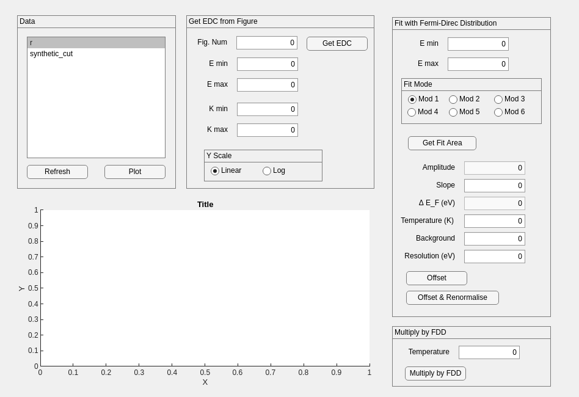
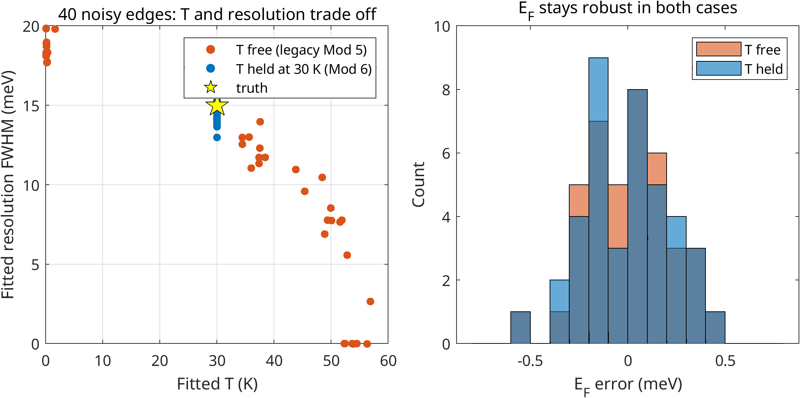
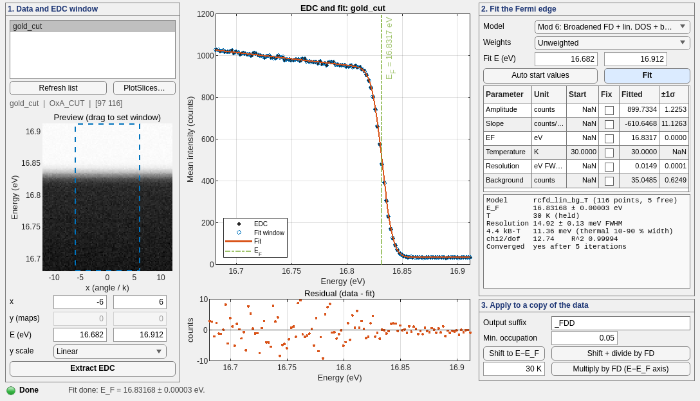

# Review of the FDD Fermi-edge fitting software

> Historical review record (23 November 2026). The reviewed program `FDD_new.mlapp` /
> `FDD_new_exported.m` is **not** part of this repository; line numbers refer to that export.
> The upgrade is maintained here in `GUI/FDD/` (`FDD_fit_app` and `fdd_*`);
> see the [user guide](FDD_user_guide.md), [improvement log](FDD_improvement_log.md) and the
> [`ox-arpes-fdd-fit` skill](../AI_skills/ox-arpes-fdd-fit/SKILL.md).

* **Date:** 23 November 2026
* **Reviewed:** Google Drive folder `FDD` (owner: Calvin Peng). Main program `FDD_new.mlapp`
  (App Designer, last modified 19 May 2023) and its export `FDD_new_exported.m` (760 lines),
  `README.md`, and the prototypes in `others/`.
* **Method:** the yulinARPES `AI_skills/improve-scientific-guis` workflow (yulinARPES commit
  `56f394e`): source review, MATLAB Code Analyzer, numerical checks against independent
  calculations, behavioural GUI/API tests, and screenshots. The worked examples
  `doc/plotBZ_V1_review.md` and `doc/plotBZ_V1_improvement_log.md` set the format.
* **Runtime:** MATLAB R2023a Update 8 on the Linux analysis box, base MATLAB only
  (no Curve Fitting, Optimization, Image Processing or Statistics Toolbox), run as the normal user.
* **Data:** synthetic Fermi edges with known E_F, T and resolution. The truth was computed by
  direct numerical integration (`integral`), independently of the code under test.
  `others/matlab.mat` (173 MB) was too large to download with the available Drive tool, so
  **no measured data were used**.
* **Original files:** downloaded read-only to a local working folder and never modified.
  The upgrade is a separate copy (see the [improvement log](FDD_improvement_log.md)).

Line numbers refer to `FDD_new_exported.m`. Its code is identical to the code inside
`FDD_new.mlapp` apart from the class name (lines 1 and 737), which I checked by unzipping
the `.mlapp` and diffing `matlab/document.xml`.

## 1. Summary

`FDD_new` is an App Designer GUI that takes an EDC from an image in a MATLAB figure, fits it
with one of six Fermi-Dirac models ("Mod 1" to "Mod 6"), and writes a copy of the data with
the energy axis shifted to E − E_F and optionally divided by the fitted Fermi function.

**The core physics is right.** The Fermi function `1/(exp((E−E_F)/k_B T)+1)`, the Boltzmann
constant (8.617333262×10⁻⁵ eV/K, CODATA 2018), the FWHM-to-σ conversion and the Gaussian
convolution in `FermiDiracDistribution` (lines 70–77) are correct. Against the independent
integral the broadened function agrees to 5.7×10⁻⁷. Results are written to new
base-workspace variables, never back onto the source.

**The main problems are around that core:**

1. **It can't fit on this machine.** Every fit mode needs the Curve Fitting Toolbox, and
   EDC/area selection needs the Image Processing Toolbox. Neither is installed, and the
   README doesn't say they're needed.
2. **The recommended mode is ill-posed.** Mod 5 fits temperature and resolution at the same
   time, and on noisy data a single edge can't separate them. Over 40 synthetic edges
   (truth: 30 K, 15 meV), T came out as 30.1 ± 23.0 K and FWHM as 11.5 ± 6.7 meV. Holding T
   at the true value gave 15.12 ± 0.91 meV. E_F stays accurate either way (±0.22 meV).
3. **Two correction buttons fail on OX_ARPES data.** "Offset & Renormalise" fails for 3-D
   maps, and "Multiply by FDD" fails for any cut whose axes are row vectors (the OX_ARPES
   convention). Both are array-shape errors.
4. **The fits are fragile.** Log-space fits break on zero counts, start values are hard-coded,
   ad-hoc clipping alters the renormalised data, and the temperature field serves as both
   input and output. No uncertainties or goodness of fit are shown.

## 2. Findings

Severity: **Critical** = blocks use; **High** = wrong or failed result in a normal workflow;
**Medium** = can mislead or is fragile; **Low** = usability or maintenance.

| # | Severity | Finding | Evidence (file:line) |
|---|---|---|---|
| F1 | Critical (environment) | **Toolbox dependencies.** `fittype`, `fit` and `coeffvalues` (Curve Fitting Toolbox) are used by all six modes. `getrect` (Image Processing Toolbox) is the only way to choose the EDC and fit area. None of them exist on the box (`exist()` = 0), so no fit and no selection can run there. The README lists no requirements. | 105, 147, 179–182, 199–202, 227–241, 259–263, 283–299, 321–336 |
| F2 | High (science) | **T and resolution are fitted together (Mod 5, "[recommand]" in the README).** Over 40 noisy edges (30 K, 15 meV FWHM, about 1000 counts) the fitted T ranged from 0.1 K (the lower bound) to 56.8 K and FWHM from 0 to 19.9 meV, with mean T 30.1 ± 23.0 K and FWHM 11.5 ± 6.7 meV. The fitted RSS was always ≤ the RSS at the true parameters, so this comes from the data, not the optimiser. With T held, FWHM = 15.12 ± 0.91 meV. E_F is unaffected (error 0.00 ± 0.22 meV). | 295–305; README "Mod 5 … [recommand]"; Fig. 3 |
| F3 | High | **"Offset & Renormalise" fails for 3-D maps.** `repmat(data.z,1,nx,ny)` with an OX_ARPES row-vector `z` gives an array of size [nz·nx, ny] instead of [nx, ny, nz]. Reproduced: "Arrays have incompatible sizes for this operation". The 2-D path (line 380) uses `data.y(:)` and works. | 383 |
| F4 | High | **"Multiply by FDD" fails for OX_ARPES cuts** for the same reason: `repmat(data.y,1,nx)` with row `y` gives size [ny·nx, 1]. Reproduced with a 21×76 cut. It also has no 3-D branch. The temperature field defaults to 0, which gives factors [1, NaN, 0] at E = −10, 0, +10 meV. | 432–436, 720 |
| F5 | High | **Log-space fitting** (Mod 2 and 3, and the first stage of Mod 5 and 6) fits `log(EDC)`. Zero counts above E_F give −Inf (26 of 116 bins in a test EDC), and a negative fitted background makes the model complex. It also reweights the residuals towards the background tail. | 199–201, 227–240, 283–285, 321–323 |
| F6 | Medium | **Mod 5 and 6 fix the background from an unbroadened first fit**, and Mod 5 also takes its starting T from it. On a 30 K / 15 meV edge that stage returns T_eff = 54 K and B = 38.7 (true value 40). The background then stays fixed during the broadened fit. | 283–291, 296, 297, 321–328, 333 |
| F7 | Medium | **Hard-coded start values:** E_F = 0, T = 30 K, resolution = 0.03 eV, slope = 1. Data on a kinetic-energy axis must be shifted by hand first; the README says the edge "should be around 0 eV". There are no parameter bounds, so negative T or resolution are accepted. | 180, 200, 228, 261, 284, 297, 322, 334 |
| F8 | Medium | **Arbitrary changes to the data.** The renormalised EDC is clipped at 2×`EDC_new(1)` (the first EDC sample). The renormalised map is clipped at 8×`EDC_new(1)` above E_F and negatives are set to 0. In a test EDC the clip at 2×EDC(1) changed 24 % of points, starting 26 meV above E_F. The thresholds depend on whichever EDC was selected, which may not even be the dataset being corrected. | 191, 211, 252, 273, 310, 346, 410–412 |
| F9 | Medium | **The temperature field is both input and output.** Mod 1–5 write the fitted (or resolution-inflated) T into the field that Mod 6 reads as the fixed temperature. Running Mod 6 after another mode silently holds T at the previous fit's value. The default 0 K gives division by zero. | 186, 206, 234, 245, 267, 304, 333 |
| F10 | Medium | **Fit quality is not reported.** `gof` is computed and discarded, and there are no uncertainties, residuals or convergence checks. A failed or degenerate fit looks the same as a good one. | 181, 201, 240, 262, 298, 335 |
| F11 | Medium | **Fragile EDC extraction.** The first graphics object with `XData` is used (`dataObjs(1)`), which depends on child order: crosshairs, lines and overlays in PlotSlices figures can come first. The code assumes energy on the image y-axis, and Fig. Num defaults to 0. I couldn't run this path here because `getrect` is missing. | 104–126 |
| F12 | Medium (scope) | **One E_F for the whole cut or map.** The shift is a single scalar. A curved, angle-dependent gold edge (analyser slit curvature) can't be corrected. | 366–368, 379–383 |
| F13 | Low | **`FermiDiracDistribution` robustness.** `Resolution = 0` returns NaN (0/0 in the kernel). Negative resolution gives the same result as positive. Adaptive `integral` with `ArrayValued` took about 25–57 ms per 116-point evaluation in four runs here (the rewrite took about 3–20 ms) and scales with the size of a whole map in Offset & Renormalise. | 70–77, 400–407 |
| F14 | Low | **Model form.** Mod 5 and 6 multiply the linear DOS by the *broadened* FD instead of broadening the product. The difference is at most 1.7×10⁻³ of the amplitude in the test case: negligible, but not exact. | 295–296, 332–333 |
| F15 | Low (GUI) | **Usability.** Output-only fields look editable (E/K min and max, fit-window E min and max; changing them has no effect). Mode names "Mod 1–6" don't describe the models. Typo "Fermi-Direc". Placeholder axes "Title/X/Y". The y-label says "Sum" for a mean. Mod 2 draws its curves twice. The data list shows every workspace variable (e.g. `ans`). Callbacks have no error handling. Output variables are overwritten without asking. | 110–113, 151–152, 134, 177, 213–217 + 351–354, 455–458, 562, 86–93, 370, 414, 438 |
| F16 | Low (code) | **Code quality.** Six near-duplicate fit blocks; `kb` defined 7 times; 20 Code Analyzer notices (9 unused callback arguments, 9 unused assignments including `gof`, 2 `ndims` → `ismatrix`). No tests. | whole file |
| F17 | Info | **`others/` folder.** Prototypes. `EDC_compare.m` is empty (0 bytes). `FIT.mlapp` and `VoigtFit.mlapp` differ only in class name and one indentation, and contain no fitting code. `plot_EDC.m` and `EDC_stack.m` hard-code scan names. `RC_FDD.m` and `FDD.m` are the scripts the app's models grew from. | `others/*` |

### What is done well

* Correct FD sign convention (E − E_F < 0 occupied), k_B and FWHM↔σ conversion. The broadened
  edge matches an independent integral to 5.7×10⁻⁷ (check [2]).
* Results are written as new variables (`_offset`, `_FDD`, `_xFDD`); the selected source
  variable isn't overwritten.
* The six modes cover the usual hierarchy of Fermi-edge models, and Mod 6 (T held) is the
  physically right choice for resolution calibration.
* The original GUI opens in R2023a (Fig. 1); only the fit and selection steps need the missing toolboxes.

## 3. Evidence

All numbers come from the review script `review_original_checks.m` (output in
`review_original_checks.txt`), kept with the standalone working copy and not added to this
repository because it needs the original program. It runs verbatim copies of the original code where base
MATLAB allows. The fit-dependent findings (F2, F6) use a base-MATLAB re-implementation of
the same model, because `fit` isn't available. They describe the **model and data**, not
the Curve Fitting Toolbox optimiser itself.

| Check | Result |
|---|---|
| [1] toolbox functions | `fit`, `fittype`, `coeffvalues`, `getrect`: all `exist()` = 0 |
| [2] original broadened FD vs independent integral | max difference 5.7×10⁻⁷ (the new model: 9.5×10⁻¹⁰) |
| [2b] edge cases of the original FD | Resolution 0 → `[NaN NaN NaN]`; T = −30 K → inverted edge `[0.056 0.944]`; Resolution −0.015 → same as +0.015 |
| [3] 3-D renormalise array (line 383) | size(EE) = [2121 11] vs value [21 11 101] → error |
| [4] log of an EDC with zero counts | 26 of 116 values are −Inf |
| [5] unbroadened first stage on a 30 K / 15 meV edge | T_eff = 54.0 K, B = 38.7 (true 40), E_F = 12.31 meV (true 12.30) |
| [6] linear DOS inside vs outside the convolution | max difference 1.66×10⁻³ of the amplitude |
| [7] clip at 2×EDC(1) | changes 24 % of points, starting 26 meV above E_F |
| [8] Multiply by FDD at T = 0 | factors [1 NaN 0] |
| [8b] Multiply by FDD on a 21×76 cut with row axes | size(EE) = [1596 1] → error |
| [9] 40 noisy edges | T free: T = 30.1 ± 23.0 K, FWHM = 11.5 ± 6.7 meV, E_F error 0.00 ± 0.22 meV. T held: FWHM = 15.12 ± 0.91 meV, E_F error 0.003 ± 0.218 meV |
| Code Analyzer, `FDD_new_exported.m` | 20 notices (listed under F16) |

## 4. Recommendations, as applied in the upgrade

1. **Remove the toolbox dependencies:** a small Levenberg–Marquardt fitter in base MATLAB,
   and EDC selection by numeric windows or a drag rectangle on an in-app preview instead of `getrect`. (F1, F11)
2. **Make "T held at the measured temperature" (Mod 6) the default** and flag a T–resolution
   correlation |r| > 0.9 whenever both are free. (F2)
3. **Fit in linear space with all parameters together**, including the background, with
   data-driven start values that work on kinetic-energy axes. Report 1σ errors, χ²/dof,
   R², convergence and residuals. (F5–F7, F10)
4. **Fix the array shapes** for cuts and maps of both OX_ARPES objects and structs. Replace
   the clipping with a documented occupation cut-off (samples where f < 0.05 → NaN) and
   don't change any other values. (F3, F4, F8)
5. **Separate inputs from outputs** in the GUI: a parameter table with Start / Fix / Fitted / ±1σ,
   descriptive model names (legacy "Mod N" kept), confirmation before overwriting a variable,
   and error dialogs. (F9, F15)
6. **Split the numerics into tested functions** shared by the GUI and a scriptable API, add an
   operation skill, and add regression tests. (F16)
7. **Keep as documented limits:** a single E_F per dataset (F12); measured gold reference
   data not yet tested.

## 5. Upgrade outcome (short)

Details are in the [improvement log](FDD_improvement_log.md). The upgraded copy (now
`GUI/`: `FDD_fit_app` plus `fdd_*` functions) passes **20 of 20 tests**
in R2023a and has **0 Code Analyzer notices** in all 18 upgraded `.m` files (code and tests). It recovers
known parameters exactly on noiseless data in all six modes, and to within the reported
errors on noisy data. Example from the GUI on a synthetic cut on a kinetic-energy axis:
E_F = 16.83173 ± 0.00014 eV (true 16.83170), FWHM = 14.86 ± 0.52 meV (true 15.0), T held at 30 K.

## 6. Limits of this review

* No measured data: the only candidate, `others/matlab.mat`, was not downloaded. The scientific
  conclusions are from synthetic edges with Gaussian counting noise.
* The original Curve-Fitting-Toolbox fits and `getrect` selection could not be run. Their
  behaviour is inferred from the source, plus runs of the same models in base MATLAB.
* The original GUI was only opened and captured; no callbacks were run.
* Behaviour on other MATLAB releases or operating systems was not tested.
